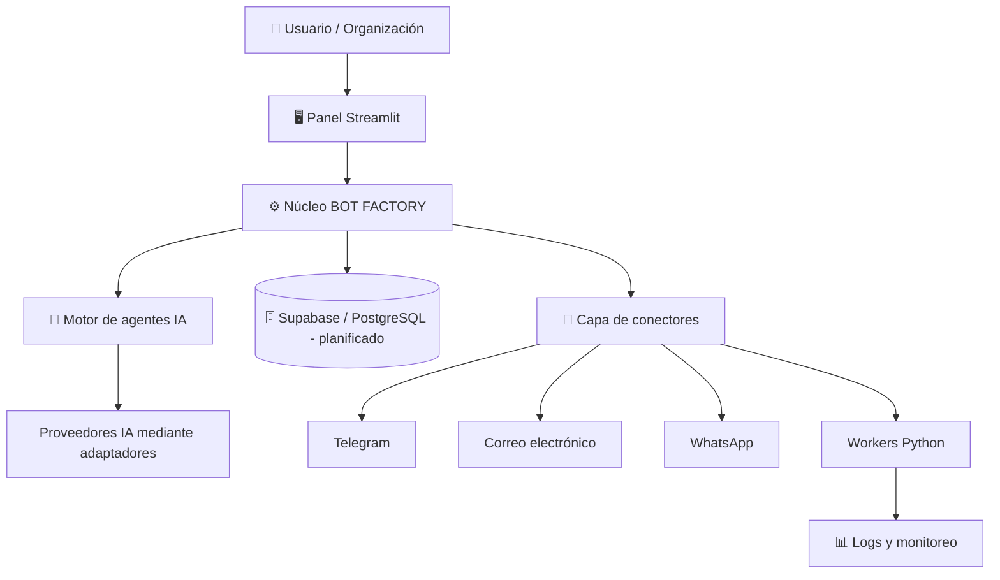

<div align="center">

# 🤖 BOT FACTORY AI

### Intelligent Automation Platform

**Crea. Conecta. Automatiza.**

Plataforma en construcción para diseñar, configurar y administrar bots y agentes de inteligencia artificial en Telegram, correo electrónico y WhatsApp. Un proyecto con enfoque **SaaS + servicios profesionales BOT FACTORY Studio**.

[](https://www.python.org/)
[](https://streamlit.io/)
[](https://supabase.com/)
[](https://telegram.org/)
[](https://www.whatsapp.com/)
[](https://www.google.com/gmail/)
[](https://github.com/hernandezjxs-alt/BOT-FACTORY-IA)

[](memoria.md)
[](bitacora_acumulada.md)
[](business_model.md)
[](DEPLOYMENT_STREAMLIT.md)

</div>

---

## 🧭 Navegación

| Sección | Contenido |
|---|---|
| [🎯 El proyecto](#-el-proyecto-en-breve) | Problema, solución y propuesta de valor |
| [✨ Capacidades](#-capacidades-y-estado-real) | Qué está implementado y qué falta |
| [🏗️ Arquitectura](#️-arquitectura-de-la-plataforma) | Componentes y tecnologías |
| [📡 Canales](#-canales-de-comunicación) | Telegram, correo y WhatsApp |
| [🧠 Motor IA](#-motor-de-agentes-ia) | Proveedores y agentes |
| [⚙️ Instalación](#️-instalación-y-ejecución-local) | Preparar el entorno |
| [🔐 Seguridad](#-configuración-y-seguridad) | Variables y secretos |
| [☁️ Despliegue](#️-despliegue-en-streamlit-community-cloud) | Publicar el panel |
| [🗂️ Estructura](#️-estructura-del-repositorio) | Organización del código |
| [🗺️ Roadmap](#️-roadmap) | Próximas etapas |
| [📚 Documentación](#-documentación-del-proyecto) | Guías y archivos de continuidad |

## 🎯 El proyecto en breve

**⚠️ El desafío.** Los negocios reciben consultas y solicitudes en distintos canales. Atenderlas manualmente, mantener respuestas consistentes y conectar cada conversación con los procesos internos consume tiempo y dificulta el seguimiento.

**✅ La propuesta.** BOT FACTORY AI busca reunir en una plataforma la creación guiada, configuración y administración de bots y agentes IA. El objetivo es que cada organización pueda diseñar automatizaciones, conectar sus canales y supervisar su operación desde un panel central.

**🚀 Modelo de negocio.** El proyecto contempla dos líneas que comparten la misma base tecnológica:

| Línea | Enfoque | Servicio |
|---|---|---|
| 🧩 **BOT FACTORY SaaS** | Autoservicio | Crear y administrar bots/agentes desde un panel, con plantillas y planes por definir |
| 🛠️ **BOT FACTORY Studio** | Implementación especializada | Diagnóstico, desarrollo a medida, integraciones, capacitación, soporte y mantenimiento |

> **Estado:** BOT FACTORY AI es actualmente un MVP/prototipo en desarrollo. La visión comercial y las pantallas diseñadas no significan que todos los canales, autenticación, persistencia o cobros estén operativos.

## ✨ Capacidades y estado real

| Módulo | Estado | Alcance actual |
|---|---|---|
| 🖥️ Panel Streamlit | 🟡 Prototipo implementado | Dashboard, navegación, formularios y vistas de administración demostrativas |
| 🤖 Registro de bots | 🟡 Prototipo implementado | Fichas de bots en memoria de sesión; no persistentes |
| 🧠 Definición de agentes IA | 🟡 Base implementada | Modelo declarativo, validación e interfaz; ejecución de herramientas aún pendiente |
| 💬 Telegram | 🟡 MVP de código | Worker independiente y comandos `/start`, `/help`, `/status`; falta validar con token real |
| 📧 Correo electrónico | ⚪ Planificado | Conector de recepción, clasificación y envío seguro pendiente |
| 🟢 WhatsApp | ⚪ Planificado | Integración oficial/proveedor autorizado pendiente |
| 🗄️ Supabase | ⚪ Planificado | Auth, persistencia, organizaciones y políticas RLS pendientes |
| 🔐 Multiempresa y roles reales | ⚪ Planificado | El selector de perfil actual es demostrativo, no un control de acceso |
| 💳 Suscripciones y pagos | ⚪ Planificado | Los planes y precios del prototipo son hipótesis, no cobros habilitados |
| 📊 Auditoría y observabilidad | ⚪ Planificado | Logs y estados productivos por completar |

**Leyenda:** 🟢 validado · 🟡 implementado parcialmente/prototipo · ⚪ planificado. No se marca como validado ningún flujo que no haya pasado pruebas reales de extremo a extremo.

## 🏗️ Arquitectura de la plataforma

La arquitectura acordada prioriza Python y Streamlit para el panel, con conectores desacoplados y servicios de ejecución independientes. **FastAPI no forma parte de la arquitectura base definida.**



| Componente | Tecnología | Responsabilidad |
|---|---|---|
| 🖥️ Panel web | Streamlit | Interfaz, configuración y administración |
| 🐍 Backend de aplicación | Python | Lógica de negocio y coordinación |
| 🧠 Proveedores IA | Adaptadores multimodelo | Integrar Gemini y preparar otros proveedores |
| 🗄️ Datos y autenticación | Supabase (planificado) | PostgreSQL, Auth, Storage y RLS |
| ⚡ Procesamiento asíncrono | Workers Python; Redis cuando corresponda | Ejecutar tareas fuera del ciclo de la interfaz |
| 🔗 Integraciones | Módulos independientes | Conectar cada canal sin acoplarlo al panel |

## 📡 Canales de comunicación

### ✈️ Telegram

**MVP de código disponible.** El repositorio incluye un worker independiente y un conector con comandos iniciales.

1. Crear el bot mediante el usuario oficial [@BotFather](https://t.me/BotFather).
2. Guardar el token en una variable privada `TELEGRAM_BOT_TOKEN`.
3. Ejecutar el worker desde el entorno Python.
4. Validar los comandos y el comportamiento con una cuenta de prueba.

> La API de Telegram no permite que una aplicación cree directamente el bot y emita su token. Ese primer paso se realiza con BotFather; la plataforma puede asistir en la configuración y administración posterior.

Guía: [📘 Telegram Connector](bot_factory/connectors/telegram/README.md).

### 📧 Correo electrónico

**Planificado.** La integración deberá contemplar recepción, clasificación, extracción de información, borradores y envío sujeto a permisos. Se evaluarán APIs/OAuth o SMTP autenticado según proveedor y caso de uso. No existe todavía un conector de correo productivo.

### 🟢 WhatsApp

**Planificado.** Se implementará mediante WhatsApp Business Platform o un proveedor autorizado, respetando consentimiento, plantillas, ventanas de conversación y políticas de Meta. No existe todavía una integración funcional desplegada.

## 🧠 Motor de agentes IA

El paquete `bot_factory/agents` contiene la base fundacional para definir agentes independientes del canal.

- 📋 Modelo declarativo `AgentSpec`.
- ✅ Validación de definiciones.
- 🔌 Contrato común `ModelProvider`.
- 🧪 Proveedor placeholder para mantener explícito lo que aún no está conectado.
- 🧠 Adaptador Gemini inicial documentado y prueba desde el panel, pendiente de validación con credenciales reales.
- 🔭 Preparación conceptual para proveedores como Anthropic/Claude, OpenAI, Gemini, DeepSeek, GLM y Ollama.

**Importante:** la definición de un agente en el prototipo no equivale a un agente autónomo en producción. La memoria persistente, herramientas ejecutables, permisos, límites y auditoría siguen pendientes.

Documentación: [📘 Agent Factory Engine](bot_factory/agents/README.md).

## ⚙️ Instalación y ejecución local

### 📋 Requisitos

- Python 3.11 o una versión compatible con las dependencias del proyecto.
- Git.
- Una terminal (PowerShell, CMD, Bash o equivalente).

### 1. Clonar el repositorio

```bash
git clone https://github.com/hernandezjxs-alt/BOT-FACTORY-IA.git
cd BOT-FACTORY-IA
```

### 2. Crear y activar un entorno virtual

**Windows (PowerShell):**

```powershell
python -m venv .venv
.venv\Scripts\Activate.ps1
```

**Linux / macOS:**

```bash
python3 -m venv .venv
source .venv/bin/activate
```

### 3. Instalar dependencias

```bash
python -m pip install --upgrade pip
pip install -r requirements.txt
```

### 4. Iniciar el panel

```bash
streamlit run app.py
```

Streamlit mostrará la dirección local en la terminal, normalmente `http://localhost:8501`.

### 5. Ejecutar el worker de Telegram (opcional)

Después de configurar `TELEGRAM_BOT_TOKEN` de forma privada:

```bash
python run_telegram_bot.py
```

## 🔐 Configuración y seguridad

El archivo [`.env.example`](.env.example) documenta nombres de variables; no contiene credenciales reales.

1. Copia `.env.example` como `.env` en tu entorno local.
2. Completa únicamente las variables necesarias para la prueba.
3. No subas `.env`, tokens, contraseñas ni claves al repositorio.
4. En Streamlit Community Cloud utiliza **App settings → Secrets**.
5. Si una credencial se expone, revócala y genera una nueva.

Variables previstas:

| Variable | Uso |
|---|---|
| `GEMINI_API_KEY` | Credencial privada para Gemini |
| `GEMINI_MODEL` | Identificador del modelo Gemini |
| `TELEGRAM_BOT_TOKEN` | Token privado del bot Telegram |
| `SUPABASE_URL` | URL del proyecto Supabase (cuando se configure) |
| `SUPABASE_ANON_KEY` | Clave pública/anon de Supabase (cuando se configure) |
| `SUPABASE_SERVICE_ROLE_KEY` | Clave privilegiada; solo backend seguro, nunca frontend |
| `REDIS_URL` | Conexión Redis opcional/futura |

**Protección de datos:** el nivel gratuito de proveedores IA puede tener condiciones de tratamiento de datos diferentes. No enviar información confidencial de clientes sin revisar las condiciones, controles y acuerdos aplicables.

## ☁️ Despliegue en Streamlit Community Cloud

El repositorio está preparado para desplegar el panel con:

- Repositorio: `hernandezjxs-alt/BOT-FACTORY-IA`
- Rama: `main`
- Archivo principal: `app.py`
- Dependencias: `requirements.txt`

Guía paso a paso: [☁️ DEPLOYMENT_STREAMLIT.md](DEPLOYMENT_STREAMLIT.md).

**La URL pública de la aplicación no se incluye aquí porque el despliegue y su dirección final deben verificarse en Streamlit Community Cloud.** El panel Streamlit tampoco sustituye la infraestructura de workers persistentes: Telegram, correo y WhatsApp necesitarán ejecución independiente para operación continua.

## 🗂️ Estructura del repositorio

```text
📦 BOT-FACTORY-IA/
├── 📄 README.md                       Presentación principal del proyecto
├── 📄 app.py                          Aplicación y panel Streamlit
├── 📄 requirements.txt                Dependencias Python
├── 📄 .env.example                    Plantilla de variables sin secretos
├── 📄 .gitignore                      Exclusiones de Git
├── 📄 run_telegram_bot.py              Punto de entrada del worker Telegram
├── 📄 DEPLOYMENT_STREAMLIT.md          Guía de despliegue
├── 📄 business_model.md                Producto y modelo comercial
├── 📄 memoria.md                       Decisiones y arquitectura vigentes
├── 📄 bitacora_acumulada.md             Historial cronológico del proyecto
└── 📁 bot_factory/
    ├── 📁 agents/                      Modelos y contratos de agentes IA
    │   └── 📄 README.md
    └── 📁 connectors/                  Conectores independientes por canal
        ├── 📄 README.md
        └── 📁 telegram/
            └── 📄 README.md
```

## 🗺️ Roadmap

| Etapa | Objetivo | Estado |
|---|---|---|
| 1️⃣ Fundaciones | Panel Streamlit, estructura Python, documentación y base Telegram | 🟡 En progreso |
| 2️⃣ Validación MVP | Pruebas locales y reales de Telegram/Gemini; estabilización del panel | ⏳ Pendiente |
| 3️⃣ SaaS seguro | Supabase Auth, organizaciones, RLS, persistencia y secretos | ⏳ Pendiente |
| 4️⃣ Multicanal | Conectores oficiales de correo y WhatsApp, workers y monitoreo | ⏳ Pendiente |
| 5️⃣ Comercialización | Onboarding, límites, costos, suscripciones y pagos | ⏳ Pendiente |
| 6️⃣ Escala | Herramientas IA seguras, base de conocimiento, integraciones y agencias | 🔭 Futuro |

## 📚 Documentación del proyecto

| Documento | Para qué sirve |
|---|---|
| [🧠 memoria.md](memoria.md) | Decisiones confirmadas, arquitectura, seguridad y estado vigente |
| [📝 bitacora_acumulada.md](bitacora_acumulada.md) | Historial de avances, cambios, feedback y pendientes |
| [🏢 business_model.md](business_model.md) | Propuesta de valor, SaaS + Studio, segmentos, planes y roadmap comercial |
| [☁️ DEPLOYMENT_STREAMLIT.md](DEPLOYMENT_STREAMLIT.md) | Publicación del panel y configuración de Secrets |
| [🧠 Agent Factory Engine](bot_factory/agents/README.md) | Modelo y contrato de proveedores IA |
| [🔌 Conectores](bot_factory/connectors/README.md) | Organización de los canales |
| [✈️ Telegram](bot_factory/connectors/telegram/README.md) | Configuración y ejecución del MVP Telegram |

## 🤝 Contribución y flujo de trabajo

1. Trabajar sobre una rama descriptiva para cambios importantes.
2. Mantener cada conector independiente.
3. No introducir secretos ni datos reales de clientes.
4. Actualizar `memoria.md` cuando cambien decisiones y arquitectura.
5. Actualizar `bitacora_acumulada.md` en cada avance relevante.
6. Documentar las pruebas ejecutadas y distinguir prototipo de funcionalidad productiva.

## 🛡️ Principios del proyecto

- 🔐 Seguridad y privacidad desde el diseño.
- 🧩 Arquitectura modular y extensible.
- 🏢 Aislamiento de información por organización.
- 🧑‍💻 Supervisión humana para acciones sensibles.
- 📡 Uso de APIs oficiales y respeto de políticas de cada canal.
- 📖 Documentación verificable y actualizada.
- 🚫 No realizar spam ni comunicaciones sin consentimiento.

## 📄 Licencia

No se declara una licencia de distribución en este repositorio por el momento. Todos los derechos se reservan al titular del proyecto mientras no se publique una licencia explícita.

---

<div align="center">

**🤖 BOT FACTORY AI**  
*Intelligent Automation Platform*

**Crea. Conecta. Automatiza.**

[⬆️ Volver arriba](#-bot-factory-ai)

</div>
